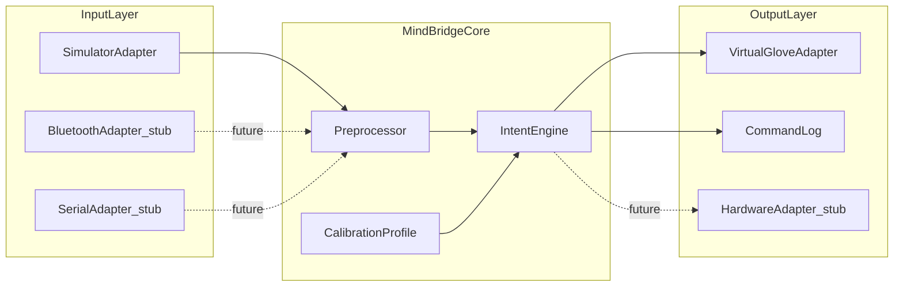
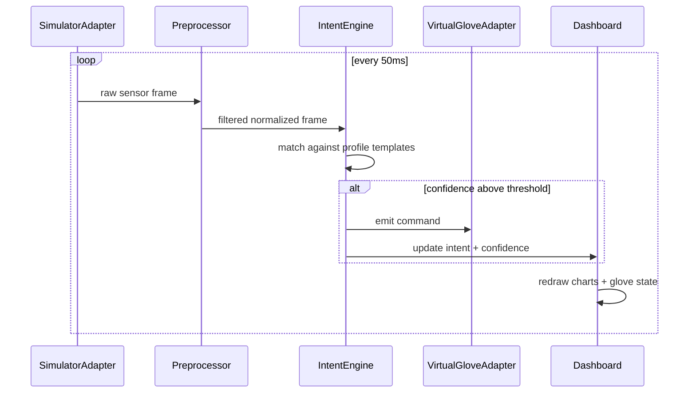

# MindBridge Working App Plan

## What the PDF specifies (and what it does not)

[mindbridge.pdf](c:\Users\patha\Downloads\MindBridge\mindbridge.pdf) is a product pitch, not a technical spec. It defines the **concept** clearly:

| Requirement from PDF | App behavior to implement |
|---|---|
| Wearable wristband captures pressure micro-signals | Simulated multi-sensor pressure stream (4–8 channels) |
| App interprets signals with adaptive, user-specific algorithms | Calibration + per-user profile + intent classifier |
| Noise / non-user stimuli filtering | Baseline subtraction, deadband, spike rejection |
| Signal amplification for weak muscle activity | Gain scaling from calibration |
| Intent → command mapping | Map pressure patterns to named commands |
| Device-agnostic output layer | Adapter pattern: virtual glove now, real hardware later |
| Real-time, MS-focused use case | Live dashboard with low-latency pipeline |

The workspace currently contains **only the PDF**—this is a greenfield build inside [c:\Users\patha\Downloads\MindBridge](c:\Users\patha\Downloads\MindBridge).

## Recommended platform: Web app

A **browser-based dashboard** is the best first demo because it:

- Runs on Windows/Mac/tablet without install friction
- Supports future **Web Bluetooth** (BLE wristband) and **Web Serial** (Arduino) adapters
- Can be wrapped in Electron/Tauri later if you want a desktop shell
- Matches your prior project style (Propulsion Studio: static web + small local server)

## High-level architecture



All adapters share one interface so swapping simulator → real sensor is a config change, not a rewrite.

## Proposed project structure

```
MindBridge/
  mindbridge.pdf
  app/
    index.html
    package.json
    vite.config.ts
    server.mjs                 # optional local dev server + static hosting
    src/
      main.ts
      styles/main.css
      core/
        pipeline.ts            # orchestrates tick loop
        preprocessor.ts        # baseline, noise gate, amplification
        intentEngine.ts        # pattern match / threshold rules
        calibration.ts         # record + store user profiles
        types.ts
      adapters/
        input/
          InputAdapter.ts      # interface
          SimulatorAdapter.ts  # sliders + auto-demo mode
          BluetoothAdapter.ts  # stub + hook points
          SerialAdapter.ts     # stub + hook points
        output/
          OutputAdapter.ts     # interface
          VirtualGloveAdapter.ts # animated glove + action feedback
      ui/
        dashboard.ts           # live charts + status
        calibrationWizard.ts   # step-by-step setup
        devicePanel.ts         # connected device view
      store/
        profiles.ts            # IndexedDB / localStorage persistence
      data/
        defaultCommands.ts     # open_hand, close_hand, pinch, rest, etc.
```

**Stack:** Vite + TypeScript + vanilla DOM (no heavy React overhead). Small Node static server like your Propulsion Studio setup.

## MVP features (what “working app” means in v1)

### 1. Live signal dashboard
- 4–8 pressure channels shown as real-time sparklines
- Current baseline, gain, and noise-gate status
- “Intent detected” indicator with confidence score

### 2. Simulator input (stand-in for wristband)
- Manual sliders per sensor for demo control
- **Auto-demo mode**: generates realistic weak/variable MS-like signals so the app is demoable without touching controls
- Adjustable noise injection toggle to prove filtering works

### 3. Calibration wizard (core differentiator)
Multi-step flow stored per user profile:

1. **Rest baseline** — record idle pressure for 5–10 seconds
2. **Command training** — user (or demo operator) holds a deliberate pressure pattern for each command (e.g., “close hand”, “open hand”, “pinch”)
3. **Validation** — app tests recognition accuracy live; allow re-record of weak commands
4. **Save profile** — persists to browser storage

**Intent matching (v1 algorithm, intentionally simple and explainable):**
- Normalize each sample: `(value - baseline) * gain`
- Compute a feature vector: per-channel activation + short rolling average
- Nearest-match against calibrated command templates using Euclidean distance
- Require confidence threshold + debounce (e.g., 300 ms stable match) before firing

This is not ML-heavy, but it **actually works**, is calibratable, and can be upgraded later to k-NN or a tiny ONNX model without changing UI/adapters.

### 4. Virtual assistive glove output
- SVG/canvas hand that animates on command: open, close, pinch, rest
- Command log with timestamps
- “Device connected” panel showing last command sent

### 5. Hardware-ready adapter stubs
- `BluetoothAdapter` and `SerialAdapter` classes with the same `InputAdapter` interface
- UI shows “Connect hardware (coming soon)” with documented expected packet format, e.g.:

```json
{ "t": 1717000000, "sensors": [0.12, 0.08, 0.31, 0.05, 0.19, 0.11] }
```

When real hardware exists, only the adapter + packet parser need implementation.

## Data flow (runtime loop)



Target loop: **20 Hz** processing (50 ms)—fast enough to feel real-time in a demo.

## UI screens

1. **Dashboard** — default view; live signals, detected intent, glove animation, command log
2. **Calibrate** — wizard for baseline + command training
3. **Profiles** — create/switch/delete user profiles (simulates per-MS-patient tuning)
4. **Devices** — simulator controls + future hardware connection panel
5. **About** — short explanation aligned with PDF value prop (for judges/demo audience)

Design: clean medical-assistive aesthetic (high contrast, large controls, accessibility-first—important for the stated MS audience).

## Implementation phases (how I would build it)

### Phase 1 — Scaffold and loop
- Initialize Vite + TS project under `app/`
- Define core types and adapter interfaces
- Implement `SimulatorAdapter` + 20 Hz pipeline
- Basic dashboard with live charts

### Phase 2 — Signal processing
- Baseline capture, noise gate, gain amplification
- Visual proof that noise toggle vs filter toggle changes output

### Phase 3 — Calibration + intent engine
- Wizard UI for rest + command recording
- Template storage in IndexedDB
- Command recognition with confidence + debounce

### Phase 4 — Virtual glove + device layer
- `VirtualGloveAdapter` with animated states
- Command log, profile switching, auto-demo mode

### Phase 5 — Hardware hooks + polish
- Stub BLE/Serial adapters + documented packet schema
- `server.mjs` + `start.bat` for one-click local launch (Windows-friendly)
- README with demo script for presentations

## Out of scope for v1 (explicitly deferred)

- Real BLE/serial hardware integration (stubbed only)
- Cloud accounts, HIPAA-grade backend, or clinical validation
- ML model training pipeline
- Physical robotic glove control (unless you later provide a protocol)

These can be Phase 2 after the simulator MVP proves the intent-translation loop.

## Demo script (what you’ll be able to show)

1. Open app → create profile “MS Demo User”
2. Run calibration: rest → train “close hand” / “open hand” / “pinch”
3. Switch to Dashboard → enable auto-demo or move sliders
4. Watch filtered signals → intent detection → virtual glove moves
5. Toggle noise injection → show false triggers blocked by filter
6. Open Devices panel → show hardware adapter interface ready for future wristband

## Key files I will create first

- [app/src/core/pipeline.ts](app/src/core/pipeline.ts) — ties everything together
- [app/src/adapters/input/SimulatorAdapter.ts](app/src/adapters/input/SimulatorAdapter.ts) — demo input
- [app/src/core/intentEngine.ts](app/src/core/intentEngine.ts) — calibration-based command detection
- [app/src/adapters/output/VirtualGloveAdapter.ts](app/src/adapters/output/VirtualGloveAdapter.ts) — visible output
- [app/src/ui/calibrationWizard.ts](app/src/ui/calibrationWizard.ts) — user-specific setup

## Risks and mitigations

| Risk | Mitigation |
|---|---|
| PDF lacks technical detail | Encode reasonable defaults; keep algorithms simple and documented |
| Real MS signal variability | Auto-demo mode + per-profile recalibration |
| Browser hardware APIs vary | Simulator-first; BLE/Serial behind adapters with graceful fallback |
| Over-scoping | Strict MVP: simulate → calibrate → detect → animate glove |

## Success criteria

The app is “working” when a user can:

- Calibrate a personal profile from simulated sensors
- See real-time pressure visualization and filtering
- Reliably trigger named commands that animate a virtual glove
- Switch profiles and persist settings across reloads
- See a clear path to plug in real wristband hardware later
